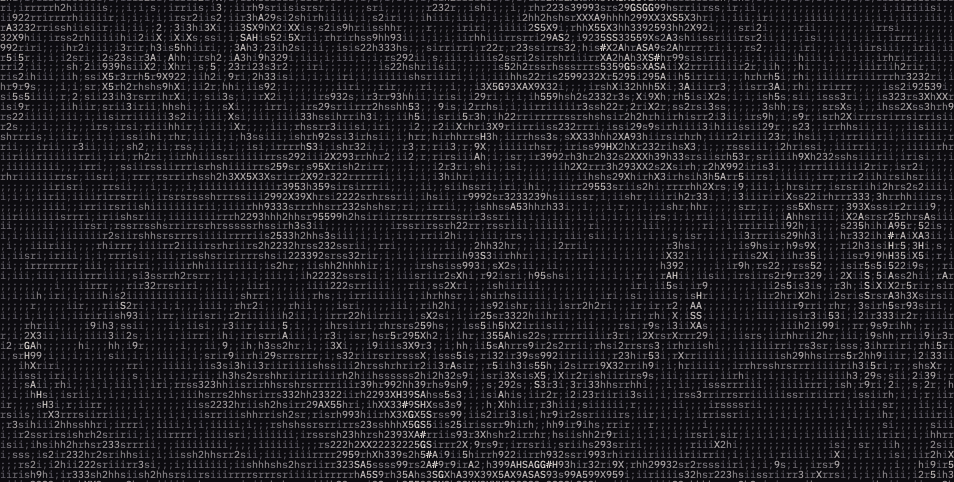
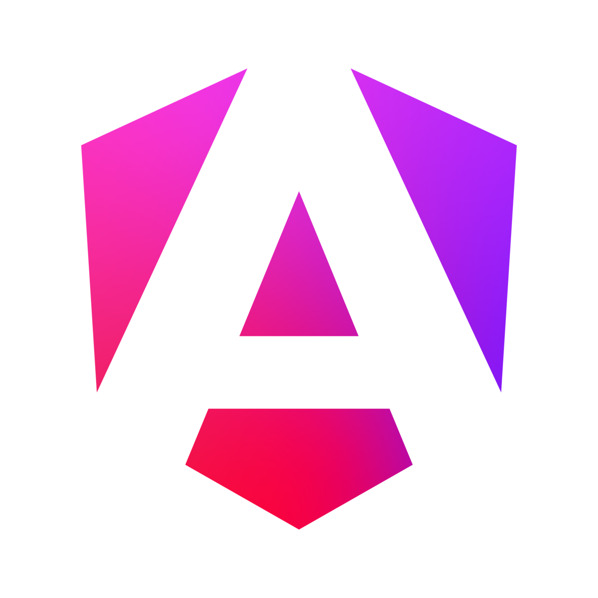
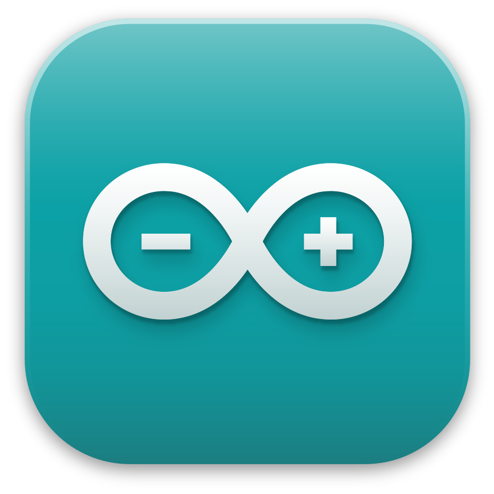
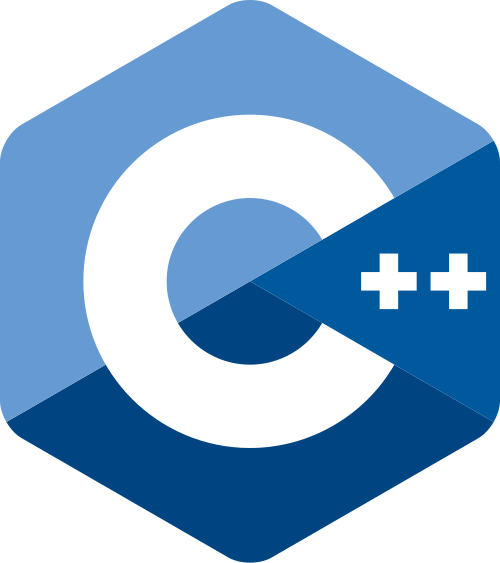
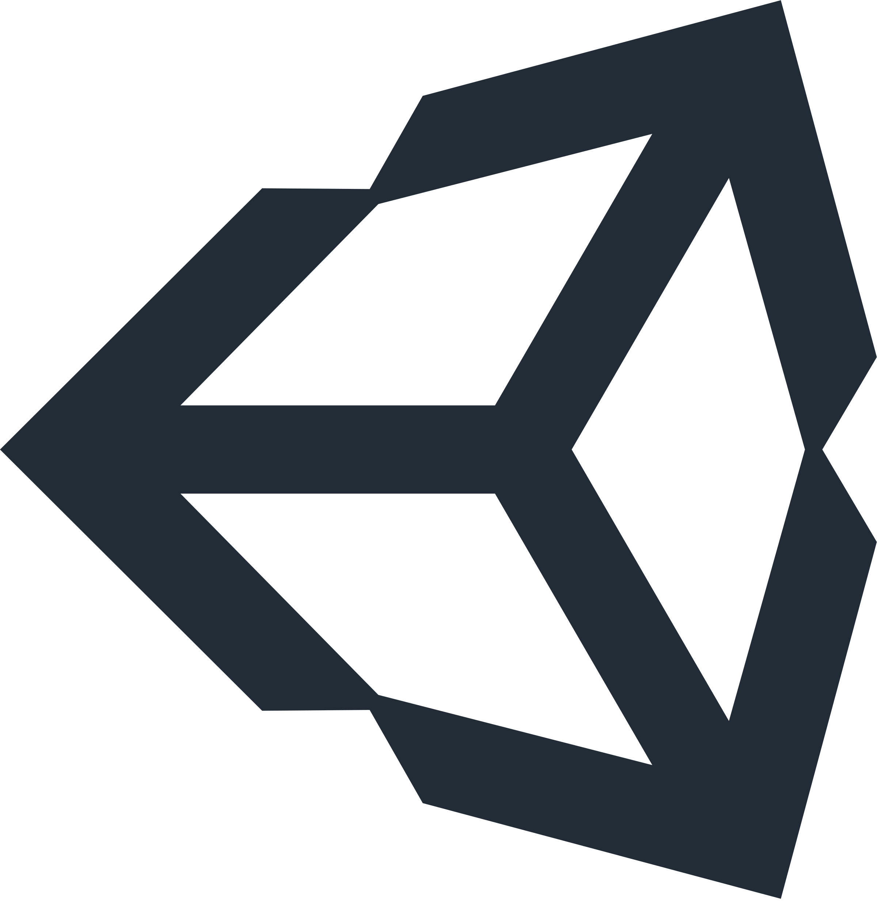
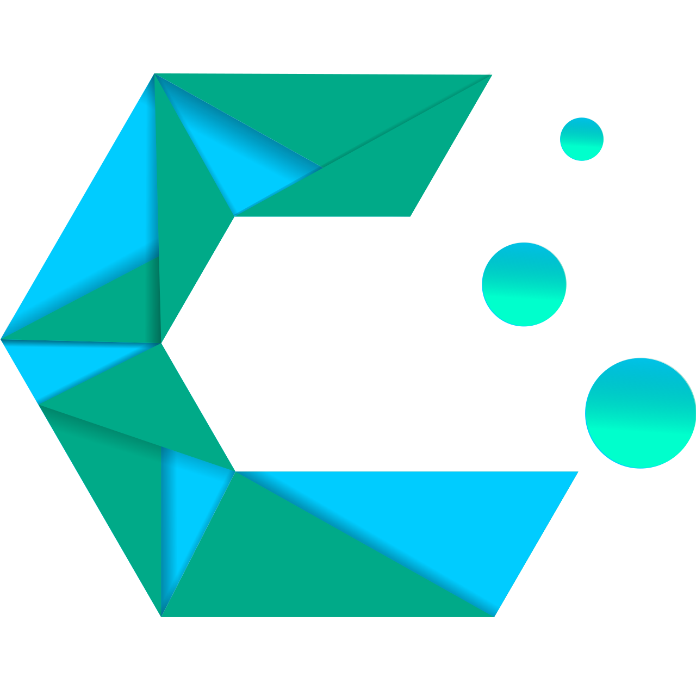

  

<h1>Hi, I'm Felix 👋</h1>

  <strong>CS Student · Logic-First Full-Stack · Hobby Architecting</strong>

  
  
  

---

## About Me

- Currently finishing my **CS degree** and working on personal projects
- I prefer **backend development** and **system architecture** over UI styling, but I can handle both
- Making complex systems and managing automation makes work fun

 

---

## Currently Working On 

  

---

## Featured Projects

  
  &nbsp;
  
   
  
  &nbsp;
  
   
  

---

## Side Projects & Experiments

  
  &nbsp;
  
   
  
  &nbsp;
  

---

## Tech Stack & Environments

| Category | Technologies |
| :--- | :--- |
| **Confident With** | &nbsp;&nbsp;&nbsp;&nbsp;&nbsp;&nbsp;&nbsp;&nbsp;&nbsp;&nbsp;&nbsp;&nbsp;&nbsp;&nbsp;&nbsp;&nbsp;&nbsp;&nbsp;&nbsp;&nbsp; |
| **Currently Learning** | &nbsp;&nbsp;&nbsp;&nbsp;&nbsp;&nbsp;&nbsp;&nbsp;&nbsp;&nbsp;&nbsp;&nbsp; |
| **Want to Level Up** | &nbsp;&nbsp;&nbsp;&nbsp;&nbsp;&nbsp;&nbsp;&nbsp;&nbsp;&nbsp; |
| **Operating Systems** | &nbsp;&nbsp;&nbsp;&nbsp;&nbsp;&nbsp;&nbsp;&nbsp;&nbsp;&nbsp; |

---

## GitHub Stats

  
  &nbsp;
  

---

## Let's Connect

Always happy to chat about code, game dev, music, or any ideas you have

  
  &nbsp;&nbsp;
  

  <strong>Discord:</strong> <code>skinnydevi</code> &nbsp;·&nbsp;
  <strong>Email:</strong> <a href="mailto:skinnydevi.dev@gmail.com">skinnydevi.dev@gmail.com</a>

 

Thanks for stopping by! 👋

