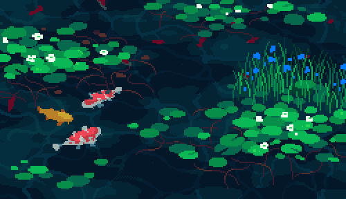
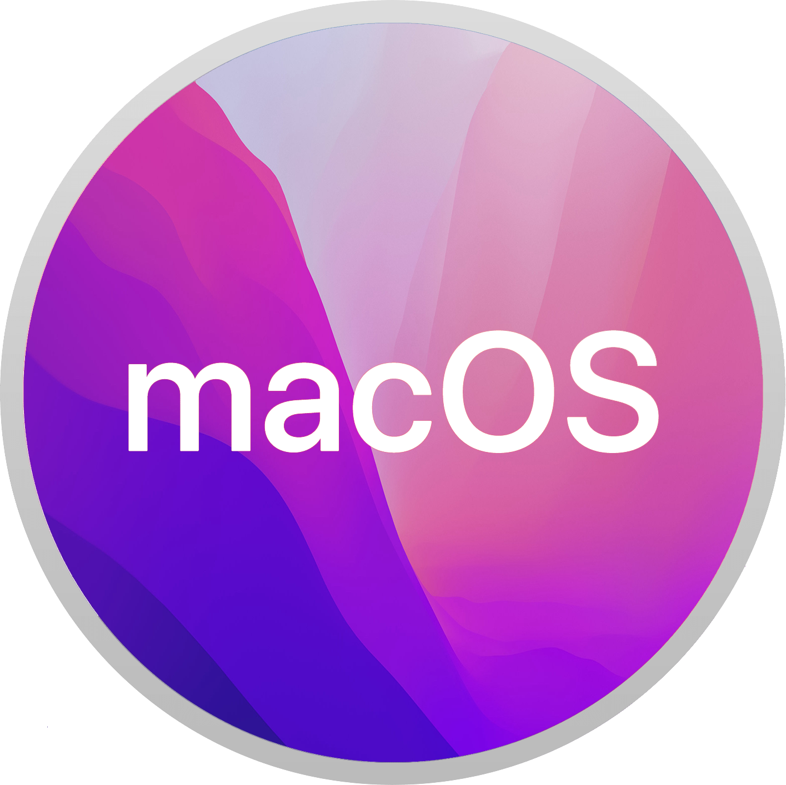
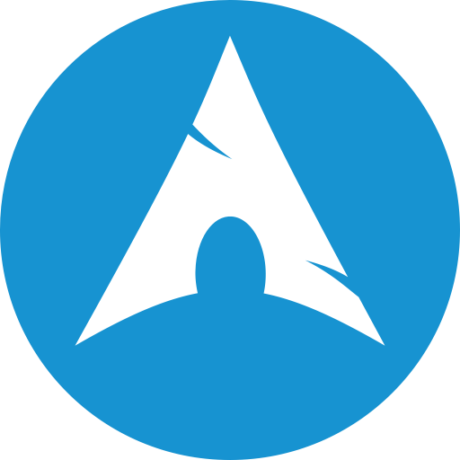
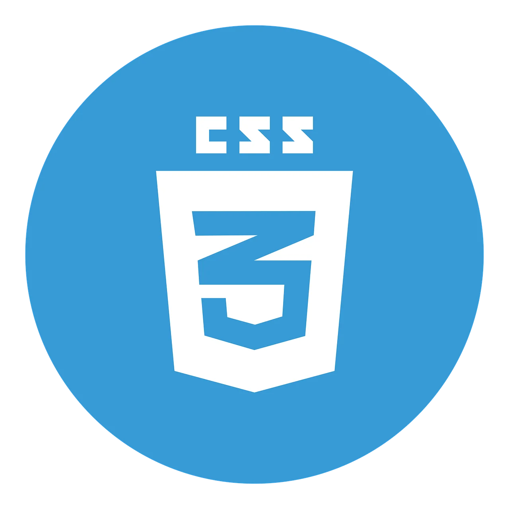
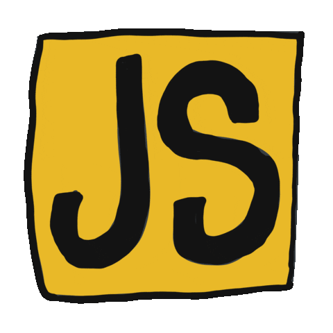
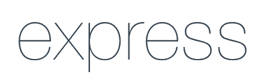

<h1>Hi!  Seems you finally landed here.  I'm Felix. Nice to have you!</h1>

  
  

<h2>Some facts about me 💬</h2>
- 🚀 I'm currently learning software development and studying computer science in university. 
- 💾 I prefer the logic side of frontend and backend rather than styling the frontend. 
- 🎮 Videogames are very entertaining and I aim to be build one in a near future. 
- 🎧 Music is something I cannot live without. I mainly listen to EDM music! 
- 🌑 I really like coding at night, although working in the morning makes a better schedule. 
- 🎾 Sport isn't my forte, but I really like tennis and bowling. 
- 👓 My current favourite programming languages are <strong>Java</strong> and <strong>TypeScript</strong>. 
- 🍙 I strive to travel to Japan and learn their culture 

<h2>Projects that I've made and make me proud 😄</h2>

<h2>What I'm currently working on👨🏽‍💻</h2>

<h2>Some side projects I like to work on for fun 🎲</h2>

<h2>My knowledge when it comes to coding 💻</h2>
<h3><strong>Operating Systems I normally work on 💾</strong> </h3>

  
  
  
  

<h3><strong>Languages and Frameworks I am confident working on ⌨️</strong></h3>

  
  
  
  
  
  
  
  
  
  
  

<h3><strong>Tools, Languages and Frameworks I am currently learning and working on ⚙️</strong></h3>

  
  
  
  
  
  
  

<h3><strong>Languages and Frameworks I would like to get better at 🛠</strong></h3>

  
  
  
  
  
  

<h2>Where can you contact me? 📲</h2>
<h3>I'm available in the following social media:</h3>

  
  
   Discord - skinnydevi

   

Or you can simply send me an email: 
  <a href="mailto:skinnydevi.dev@gmail.com">skinnydevi.dev@gmail.com</a>

---
<h2>Thanks for passing by! </h2>
